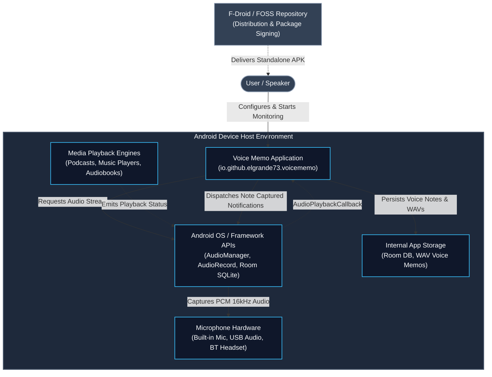
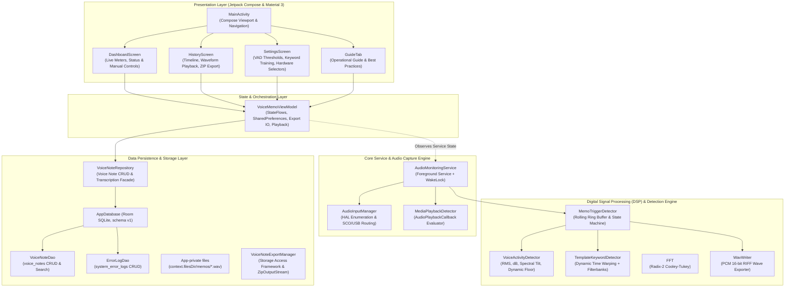

# System & Software Architecture Documentation (arc42 Aligned)

**Application:** Voice Memo (Automatic Voice-Note Assistant for Android — FOSS / F-Droid Distribution)  
**Application ID / package:** `io.github.elgrande73.voicememo` (formerly `com.aistudio.ciaolinda`, see [README](README.md#new-application-identity))  
**Default wake phrase:** "Ciao Linda"  
**Target Platform:** Android 7.0 (API Level 24) through Android 15 / 16 (API Level 36)

---

## 1. System Context

The application runs entirely on-device in a sandboxed, zero-telemetry environment. It interfaces directly with Android HAL audio endpoints (Internal Microphones, USB Audio interfaces, Bluetooth SCO/BLE peripherals) to passively monitor acoustic activity, recognize a wake phrase (default "Ciao Linda"), and record automatic voice notes without cloud dependencies.

### System Context Diagram

**Context Characteristics:**
- **No Remote Backend / Cloud**: There is **no cloud server, analytics ingestion endpoint, or remote AI API**.
- **No Third-Party Tracker SDKs**: Relies strictly on standard Android Open Source Project (AOSP) APIs and Jetpack libraries.
- **Privacy-First**: Audio recordings are stored in private internal app storage.

---

## 2. Application Building Blocks (Decomposition View)

The application adheres to modern Android Architecture (MVVM + Foreground Service + Unidirectional Data Flow).

---

## 3. Data Model

### Entity: `VoiceNote`
- `id`: Primary key (Int auto-generate)
- `title`: User-editable memo title (String)
- `timestamp`: Epoch millisecond timestamp of recording onset (Long)
- `durationSeconds`: Total duration in seconds (Double)
- `audioFilePath`: Absolute path to 16-bit PCM WAV file (String)
- `triggerType`: `AUTO_SOUND`, `AUTO_VOICE`, `KEYWORD_CIAO_LINDA` (any wake-phrase trigger; persisted value, never renamed), or `MANUAL` (String)
- `transcriptionText`: Optional on-device speech-to-text transcript (String?)
- `transcriptionStatus`: `NONE`, `PENDING`, `COMPLETED`, or `FAILED` (String)
- `peakDb`: Maximum acoustic decibel level during note (Float)
- `avgDb`: Average acoustic decibel level during note (Float)
- `isFavorite`: Bookmark flag (Boolean)

---

## 4. Key Architectural Patterns & Safety

1. **Deterministic State Machine**: Continuous transitions between `IDLE`, `MONITORING`, `TRIGGER_DETECTED`, `RECORDING`, and `SAVED`.
2. **Pre-Trigger Buffering**: Rolling circular buffer ensures the start of speech is never truncated when sound exceeds the threshold.
3. **Keyword Spotting**: Local filterbanks + DTW allows fast, zero-cloud phrase detection.
4. **Resilient Audio Routing**: Automatic device failover to phone mic if external headsets disconnect.
5. **Foreground Service Compliance**: Proper `FOREGROUND_SERVICE_MICROPHONE` type and notification channel separation for Android 14+.
6. **No destructive database migrations**: the Room schema is exported to `app/schemas/`; schema changes must ship with an explicit migration (`AppDatabase.MIGRATIONS`). `DatabasePersistenceTest` opens a database created from the committed schema with the current code.

---

## 5. Persistent User Data & Stable Identifiers

All user data lives in app-private storage (never the cache directory) and survives restarts and in-place updates of Voice Memo. The identifiers below are persisted on devices and must never be renamed:

| Data | Location / identifier | Notes |
|---|---|---|
| Voice memos (index) | Room database `voice_memo_database` | Schema in `app/schemas/` |
| Voice memo audio | `filesDir/memos/*.wav` | Referenced by absolute path from the database |
| Settings | SharedPreferences `voice_memo_preferences` | Versioned by `settingsSchemaVersion`, migrated by `SettingsMigrator` |
| Match confidence threshold | key `matchConfidenceThresholdPercent` (Int, 50–80) | Single authoritative value |
| Enrolled (custom) wake phrase | `filesDir/wake_phrase/enrolled_template.bin` | Written atomically; deleting it restores the built-in "Ciao Linda" |
| Wake-phrase test recording | `filesDir/wake_phrase/test_recording.wav` | 16 kHz mono WAV of the last "Test Phrase" run |
| Wake-phrase test result | `filesDir/wake_phrase/test_result.bin` | Best confidence + timestamp |

`SettingsMigrator` runs before any setting is read. Each step runs once (guarded by the schema version), never replaces a value the user already saved, clamps out-of-range values and replaces corrupt values with defaults without touching other keys.

---

## 6. Match Confidence Threshold

`TemplateKeywordDetector` scores each candidate window as `confidence = 1 − normalizedDtwDistance / 0.40` (0.0–1.0). The wake phrase is detected when `confidence ≥ threshold`, where `threshold = percent / 100` and `percent` is the user's **Match confidence threshold** (50 %–80 %, default 50 %). In Wake Phrase mode the audio must additionally exceed the loudness (activation) threshold.

The ViewModel holds the persisted value, passes it to `AudioMonitoringService` (applied live through `ACTION_UPDATE_MATCH_CONFIDENCE_THRESHOLD` without resetting the detector), and the dashboard shows the same value as **Trigger threshold**.

The former "keyword sensitivity" (0.10–0.95) required `distance ≤ 0.28 + (s − 0.5)·0.12` and `confidence ≥ clamp(0.42 − (s − 0.5)·0.20, 0.25, 0.75)`; `SettingsMigrator` converts a stored legacy value to the confidence threshold it effectively produced and clamps it to 50–80 %.

---

## 7. Memo Playback Sequencing

`MemoPlaybackSequencer` (pure Kotlin, unit-tested) drives playback started from the history list:

`BEGIN chime → memo audio → (natural completion) → END chime → next memo's BEGIN chime → next memo …`

- The queue is the list currently displayed (filter, search and order applied), re-read at every transition; memos removed from that list are never played. If the current memo leaves the list, the next item after its previous position that is still listed is used.
- At the end of the list the END chime plays and playback stops (no wrap-around).
- Manual stop, cancellation or audio-focus loss never play the END chime and never advance; pausing keeps the position.
- Every asynchronous callback carries a token, so duplicate or stale completion events are ignored and only one memo can start.
- Unplayable memos are skipped during automatic advance; an unplayable memo selected explicitly stops playback.
- Chimes are synthesized at runtime by `FeedbackSoundPlayer` (no bundled or downloaded audio).

---

## 8. Wake-Phrase Recognition & Microphone Ownership

- **One recognition pipeline**: `WakePhraseFrontEnd` (adaptive noise floor, spectral noise suppression, level-invariant
  features) → `TemplateKeywordDetector` (DTW) → `MemoTriggerDetector` (threshold and loudness decision). Monitoring and
  the Settings phrase test (`WakePhraseEvaluator`) both feed every 50 ms frame in order. See
  [`docs/WAKE_PHRASE_DETECTION.md`](docs/WAKE_PHRASE_DETECTION.md) for the root-cause analysis, parameters and measurements.
- **Microphone ownership**: `MicrophoneArbiter` (process-wide) grants the microphone to exactly one owner,
  `MONITORING` or `PHRASE_CAPTURE`. The service's capture loop acquires it before creating its `AudioRecord` and releases
  it after releasing the `AudioRecord`; while another owner holds it, the service waits (`WAITING_FOR_MICROPHONE`).
- **Phrase recordings** (`PhraseCaptureCoordinator`): ignore repeated taps → check permission → remember whether
  monitoring ran → stop it → wait (suspending, 3 s timeout) until the microphone is released, otherwise report an error
  and do not record → record → release → restore monitoring if it ran before and the user did not start/stop it
  meanwhile (also after failures and cancellation). `AudioMonitoringService.engineState` exposes the real engine state
  to the dashboard.

