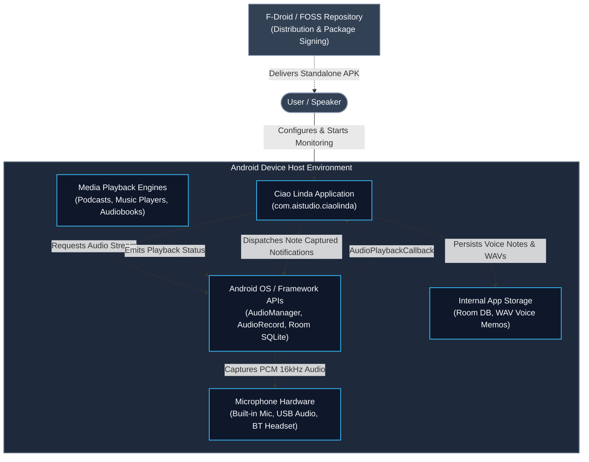
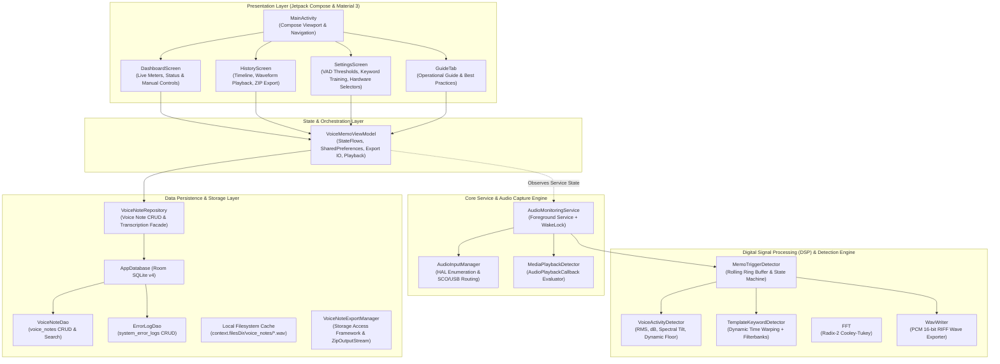

# System & Software Architecture Documentation (arc42 Aligned)

**Application:** Ciao Linda (Automatic Voice-Note Assistant for Android — FOSS / F-Droid Distribution)  
**Package:** `com.aistudio.ciaolinda`  
**Target Platform:** Android 7.0 (API Level 24) through Android 15 / 16 (API Level 36)

---

## 1. System Context

The application runs entirely on-device in a sandboxed, zero-telemetry environment. It interfaces directly with Android HAL audio endpoints (Internal Microphones, USB Audio interfaces, Bluetooth SCO/BLE peripherals) to passively monitor acoustic activity, recognize wake phrases ("Ciao Linda"), and record automatic voice notes without cloud dependencies.

### System Context Diagram

**Context Characteristics:**
- **No Remote Backend / Cloud**: There is **no cloud server, analytics ingestion endpoint, or remote AI API**.
- **No Third-Party Tracker SDKs**: Relies strictly on standard Android Open Source Project (AOSP) APIs and Jetpack libraries.
- **Privacy-First**: Audio recordings are stored in private internal app storage.

---

## 2. Application Building Blocks (Decomposition View)

The application adheres to modern Android Architecture (MVVM + Foreground Service + Unidirectional Data Flow).

---

## 3. Data Model

### Entity: `VoiceNote`
- `id`: Primary key (Int auto-generate)
- `title`: User-editable memo title (String)
- `timestamp`: Epoch millisecond timestamp of recording onset (Long)
- `durationSeconds`: Total duration in seconds (Double)
- `audioFilePath`: Absolute path to 16-bit PCM WAV file (String)
- `triggerType`: `AUTO_SOUND`, `KEYWORD_CIAO_LINDA`, or `MANUAL` (String)
- `transcriptionText`: Optional on-device speech-to-text transcript (String?)
- `transcriptionStatus`: `NONE`, `PENDING`, `COMPLETED`, or `FAILED` (String)
- `peakDb`: Maximum acoustic decibel level during note (Float)
- `avgDb`: Average acoustic decibel level during note (Float)
- `isFavorite`: Bookmark flag (Boolean)
- `fileSizeBytes`: Size on disk in bytes (Long)

---

## 4. Key Architectural Patterns & Safety

1. **Deterministic State Machine**: Continuous transitions between `IDLE`, `MONITORING`, `TRIGGER_DETECTED`, `RECORDING`, and `SAVED`.
2. **Pre-Trigger Buffering**: Rolling circular buffer ensures the start of speech is never truncated when sound exceeds the threshold.
3. **Keyword Spotting**: Local filterbanks + DTW allows fast, zero-cloud phrase detection.
4. **Resilient Audio Routing**: Automatic device failover to phone mic if external headsets disconnect.
5. **Foreground Service Compliance**: Proper `FOREGROUND_SERVICE_MICROPHONE` type and notification channel separation for Android 14+.
